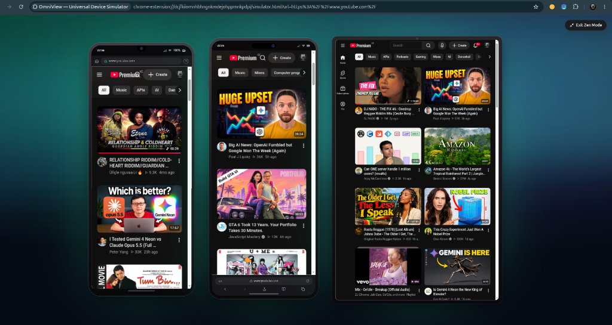
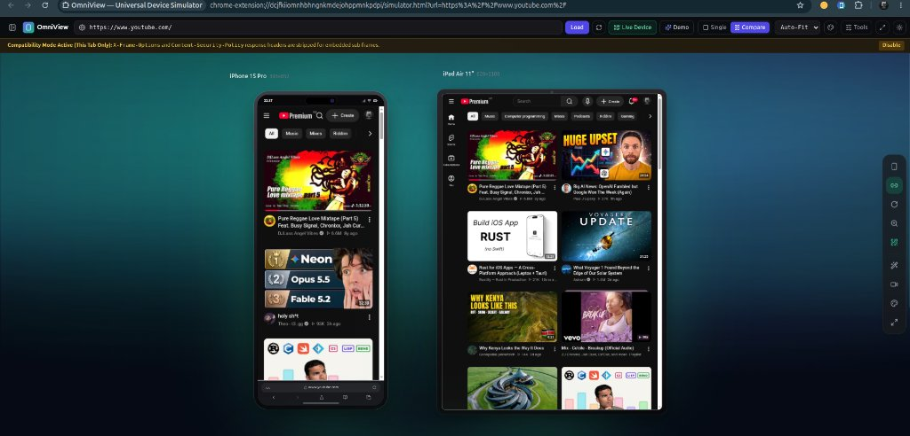
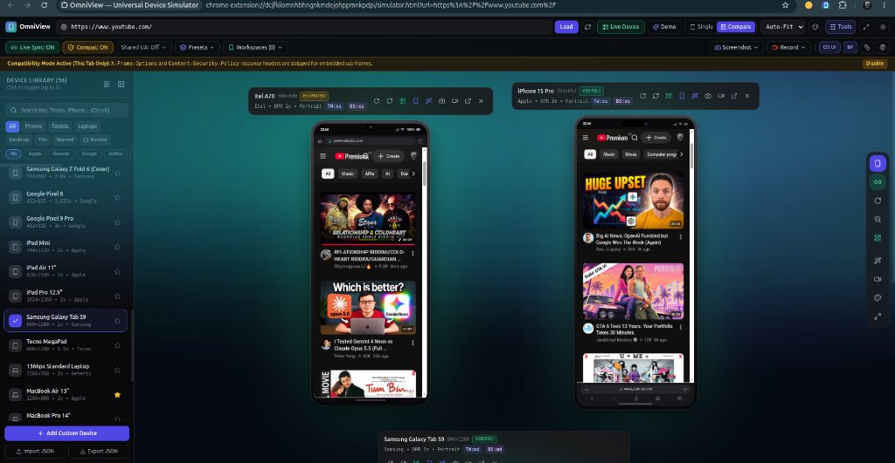
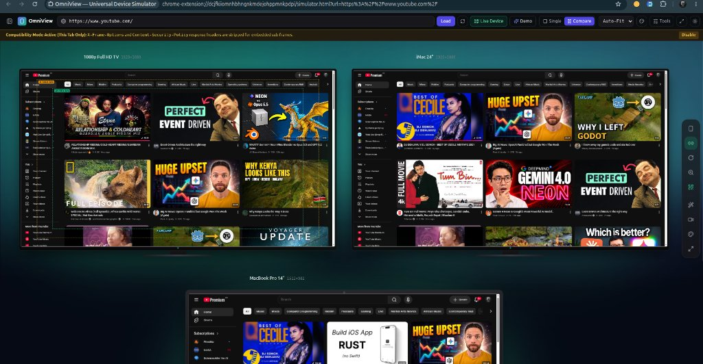
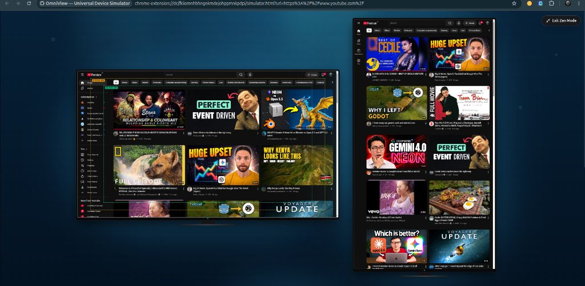

# OmniView — Universal Device Simulator

**Free, open-source Manifest V3 Chrome Extension** for responsive web testing across **both emerging-market devices** (Itel, Tecno, Infinix, Oppo, Xiaomi/Redmi) and **international flagships** (Apple iPhone, Samsung Galaxy, Google Pixel, iPads, Laptops, Macs, and Smart TVs) — with **zero PRO paywalls**.

> **[Download OmniView v1.1 Extension (.zip — 117 KB)](https://github.com/David-mwas/OmniView/raw/main/omniview-extension-v1.1.zip)** — Ready to load unpacked in Chrome, Brave, or Edge in 30 seconds (no Node.js required).

---

## OmniView in Action

### Zen Presentation Mode — Multi-Device Comparison (Itel A70 + iPhone 15 Pro + Galaxy Tab S9)



### Minimal Studio Mode — Phone & Tablet Side-by-Side with Floating Rail



### Pro Developer Toolbar — 36+ Device Library, Live Sync & Breakpoint Badges



### Smart TV & Desktop Mode — 1080p TV Overscan Safe-Area Guides, iMac 24" & MacBook Pro 14"



### Zen Mode — Landscape Smart TV + Rotated Portrait Display on Abyssal Sea Theme



---

## Quick Install (No Coding Tools Needed)

1. **[Download `omniview-extension-v1.1.zip`](https://github.com/David-mwas/OmniView/raw/main/omniview-extension-v1.1.zip)** and **unzip / extract** it into a permanent folder.
2. Open Chrome (or Brave / Edge) and go to `chrome://extensions`.
3. Enable **Developer mode** (toggle in the top-right corner).
4. Click **Load unpacked** (top-left) and select the extracted folder (the one containing `manifest.json`).
5. Pin **OmniView** from your browser's Extensions menu, then click the OmniView icon on any website to launch the simulator!

---

> **[Download OmniView v1.1 Extension (.zip — 117 KB)](https://github.com/David-mwas/OmniView/raw/main/omniview-extension-v1.1.zip)** — Ready to load unpacked in Chrome, Brave, or Edge in 30 seconds (no Node.js required).

---

## OmniView in Action

### Zen Presentation Mode — Multi-Device Comparison (Itel A70 + iPhone 15 Pro + Galaxy Tab S9)


### Minimal Studio Mode — Phone & Tablet Side-by-Side with Floating Rail


### Pro Developer Toolbar — 36+ Device Library, Live Sync & Breakpoint Badges


### Smart TV & Desktop Mode — 1080p TV Overscan Safe-Area Guides, iMac 24" & MacBook Pro 14"


---

## Quick Install (No Coding Tools Needed)

1. **[Download `omniview-extension-v1.1.zip`](https://github.com/David-mwas/OmniView/raw/main/omniview-extension-v1.1.zip)** and **unzip / extract** it into a permanent folder.
2. Open Chrome (or Brave / Edge) and go to `chrome://extensions`.
3. Enable **Developer mode** (toggle in the top-right corner).
4. Click **Load unpacked** (top-left) and select the extracted folder (the one containing `manifest.json`).
5. Pin **OmniView** from your browser's Extensions menu, then click the OmniView icon on any website to launch the simulator!

---

## Key Features

- **56+ Built-In Devices + Custom Device Manager**: Includes popular local & emerging-market phones (**Itel** A70/P55 5G/S23+, **Tecno** Spark 20/30C/30 Pro/Pova 6 Pro/Camon 30/Phantom V Fold/MegaPad, **Infinix** Hot 40/Note 40 Pro/Zero 40 5G, **Oppo** A18/Reno 11, **Xiaomi** Redmi 13C/Note 13 Pro/14 Ultra, **Huawei** Pura 70 Pro/Nova 12i, **Vivo** Y28/V30 Pro, **Realme** C67/GT 6, **Nokia** G42 5G, **Nothing** Phone 2a, **Motorola** Moto G54, **OnePlus** 12/Nord CE 4) alongside **Apple iPhone/iPad/Mac**, **Samsung Galaxy**, **Google Pixel**, **Ultrawide Monitor**, and **720p/1080p/4K Smart TVs**.
- **Accessibility & Vision Simulator**: Live per-canvas simulation for **Protanopia**, **Deuteranopia**, **Tritanopia**, **Achromatopsia**, **Blurred Vision**, and **Low Contrast / Outdoor Glare**.
- **X-Ray Layout Outlines & Horizontal Overflow Detector**: Automatic **`+Npx` Overflow Warning** badges whenever a page breaks past a device's viewport width, plus 1-click **X-Ray Outlines** that highlight overflowing DOM elements in bright red.
- **Working Browser History Navigation & Row/Grid Compare Layouts**: Back (`←`) and Forward (`→`) controls in the top bar and inside iOS Safari / Android Chrome device bars, plus **Grid Wrap** vs **Horizontal Row Strip** comparison layouts.
- **Mockup Studio v2 (Annotations + Social Aspect Ratios)**: Draw **Arrows**, **Highlight Boxes**, and **Privacy Blur** boxes directly onto screenshots, pick **16:9 / 1:1 / 4:5 / 9:16** pitch & social aspect ratios, and export PNG/JPEG/WebP or copy to clipboard.
- **Recording Preview & Clip Trimmer**: Scrub and trim start/end points right inside the Recording Preview modal and export a trimmed clip cleanly.
- **Page Inspector & QA Studio Drawer**:
  - **Page DNA**: Extracts live font families & clickable brand color palette swatches (1-click hex copy).
  - **SEO & Social Card Preview**: Live Open Graph (`og:image`, title, description) preview card.
  - **Core Web Vitals, Touch-Target Auditor & Markdown QA Report**: Real load time, CLS shift, DOM nodes, broken images, `<44px` tap-target highlighter, captured runtime errors, and 1-click Markdown QA report export.
  - **Live CSS Injector & Figma Design Comp Overlay**: Inject live CSS overrides across all devices simultaneously, or upload a Figma PNG overlay with Opacity & Pixel-Diff blend mode.
- **Command Palette (`Ctrl+Shift+P`), Mobile Realism & Showcase Tools**: Fuzzy keyboard launcher for all 56+ devices, 16 Living Themes, presets & actions; On-Screen **Virtual Mobile Keyboard** occlusion test; **Safe-Area / Notch** & **4/8/12-Column Grid** guides; **RTL** & **125%–200% Text-Scale** stress test; **Dual-URL (Staging vs Prod)** comparison; **Freeform Width Drag Resize**; **3D Perspective Tilt**; **Batch Capture All Devices**; and **Shareable Workspace Codes**.
- **Automated Releases & Chrome Web Store Ready**: Includes [.github/workflows/release.yml](.github/workflows/release.yml) for automated release zips on `v*` tags and a local-first [PRIVACY.md](PRIVACY.md).
- **Multi-Device Comparison + Real-Time Live Sync**: Compare up to **6 devices side-by-side** with **Live Sync** ([syncBridge.ts](src/content/syncBridge.ts)) — scrolling, navigating between pages (MPA & SPA), clicking menus/buttons/tabs, and typing in search/form inputs on one device mirror in real time across all other devices.
- **Run on Live Physical Device (Offline QR Code + LAN IP Helper)**: Click **Live Device** to generate an instant offline QR code for the exact live page you're inspecting — with automatic `localhost`/`127.0.0.1` LAN IP rewriting so your physical phone, tablet, or TV on the same Wi-Fi opens your local dev server in one scan.
- **Realistic OS Status Bars & Mobile Browser Chrome**: Toggle authentic iOS Safari (bottom address bar, Dynamic Island/notch, status bar) and Android Chrome (top address bar, 100% battery, punch-hole/waterdrop) overlays with one click (`OS UI`).
- **Minimal Studio Mode, 16 Living Studio Themes & Choreographed Motion**:
  - Clean Minimal Studio default with smooth slide-in sidebar drawer, accordion Pro Toolbar (`Tools`), floating right quick-action rail, staggered device entrance & smooth exit animations, and physical **3D orientation rotation** transitions.
  - **16 Living Themes across 4 Collections**: _Minimal_ (Obsidian, Graphite, Pure Paper, Warm Sand), _Cosmos & Space_ (Deep Space, Nebula Nova, Solar Eclipse, Cyber Grid), _Marine & Aquatic_ (Abyssal Sea, Coral Lagoon, Bioluminescent, Arctic Frost), and _Nature_ (Aurora, Sunset Velvet, Mystic Forest, Sakura Bloom).
  - **4 Animation Feel Presets**: _Silk_, _Spring_, _Snappy_, and _Calm_.
- **Mockup Screenshot Studio & Full-Page Scrolling Capture**:
  - **Full-Page Scrolling Capture**: Automatically scrolls the target device from top to bottom and stitches the entire page into one seamless image.
  - **Mockup Studio**: Wrap any capture (single device, raw viewport, full page, or comparison grid) in designer gradient/solid/transparent backdrops with adjustable padding, corner radius, drop shadow, and custom captions, then export as **PNG**, **JPEG**, **WebP**, or **Copy to Clipboard**.
- **Universal MP4 (H.264) & WebM Screen Recorder + Built-In Preview Player**: Prioritizes **MP4 (H.264)** when supported by Chrome (with WebM H.264 and VP9/VP8 options), selectable quality bitrate (_Standard / High HD / Ultra_), optional tab audio, Region Capture (`CropTarget.fromElement`) with full-tab fallback, and an instant built-in **Recording Preview Modal** before downloading.
- **Developer & Smart TV Testing Tools**: Toggleable Tailwind (`xs`–`2xl`) & Bootstrap (`xs`–`xxl`) breakpoint inspector, pixel ruler overlay, touch cursor indicator, TV 5% / 10% overscan safe-area guides, TV landscape lock, and an on-screen D-Pad Remote HUD.

---

## Understanding Compatibility Mode (`Compat` Flag)

Many live websites (such as YouTube, Google, news portals, and SaaS dashboards) send `X-Frame-Options` or `Content-Security-Policy: frame-ancestors` headers that block them from rendering inside a simulator `<iframe>`.

OmniView solves this using **tab-scoped `declarativeNetRequest` session rules**:

- **ON by Default (Recommended for Everyday Previewing)**: When you open an OmniView simulator tab, `Compat: ON` is enabled automatically **strictly for sub-frames inside that simulator tab's `tabId`**. It never affects your normal browsing tabs, and Chrome automatically removes the rules the moment you close the OmniView tab.
- **When to Turn `Compat` OFF**: Open **Tools → Compat: OFF** if you are specifically testing how your own site's strict `CSP` / `X-Frame-Options` headers behave in standard iframe embedding, or if you want zero header modification on your local dev server.
- **When a Site Still Refuses to Load**: A small number of websites use JavaScript frame-busters, strict `SameSite` auth cookies, or Service Worker cached CSP headers that cannot be bypassed by header rules. For those sites, click the **External Preview** (`↗`) icon on any device card or scan the **Live Device** QR code to test on a physical phone.

---

## Keyboard Shortcuts

| Shortcut               | Action                                    |
| :--------------------- | :---------------------------------------- |
| `Ctrl + K` / `Cmd + K` | Open & focus Device Library search        |
| `Shift + S`            | Toggle Real-Time Live Sync (Compare Mode) |
| `Shift + Z`            | Toggle Zen Presentation Mode              |
| `Shift + R`            | Reload all active devices                 |

---

## Development Setup, Tests & Build

```bash
git clone https://github.com/David-mwas/OmniView.git
cd OmniView
npm install
npm run test
npm run build
```

Then load the generated `dist/` folder via `chrome://extensions` → **Developer mode** → **Load unpacked**.

---

## Known Browser & API Limitations

- **Rendering Engine**: Changing the User-Agent header does not replace Chrome's Blink rendering engine with iOS Safari, Android WebView, or native Smart TV engines. Use **Run on Live Device** to verify engine-specific behavior on real hardware.
- **Multi-Device User-Agent**: Chrome's `declarativeNetRequest` scopes session rules to `tabId`, not individual `<iframe>` elements. Single Device Mode applies the active device's UA; Multi-Device Mode applies one shared UA across the tab.
- **Privacy**: OmniView is 100% local-first (`chrome.storage.local` & `chrome.storage.session`) with no backend, no analytics, and no external data transmission.

## License

MIT — see [LICENSE](./LICENSE).
